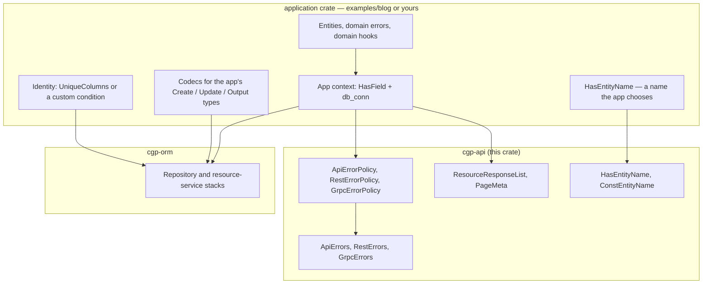

# cgp-api architecture

`cgp-api` is a **generic** application / service layer on
[`cgp-orm`](https://crates.io/crates/cgp-orm). It owns error-mapping policies, a
routing-name accessor, and transport-independent response helpers. It
does **not** own a domain model: no entities, no fixed DTO shape, and
no transport-specific payload types.

The design principle, shared with `cgp-orm`: **presets compose
behavior, contexts choose policies, and macros do not own
architecture.**

# Layers



# Error-policy presets

There is one policy preset per error table. Each forwards `ErrorType`,
`ErrorRaiser`, and `ErrorWrapper` to that table and does **not** wrap
a `cgp-orm` parent. The context adds the ORM stack:

| Policy | Error map | Typical composition |
| --- | --- | --- |
| `ApiErrorPolicy` | `ApiErrors` (`ApiError`, feature `thiserror`) | `RepositoryCrudStack + ResourceServiceStack + ApiErrorPolicy`, or `RepositoryLookupStack + ApiErrorPolicy` |
| `RestErrorPolicy` | `RestErrors` (feature `rest`) | same parents, with `RestErrorPolicy` |
| `GrpcErrorPolicy` | `GrpcErrors` (feature `grpc`) | same parents, with `GrpcErrorPolicy` |

A consumer writes a child preset that fills in:

- `EntityTypeProviderComponent`
- For a resource stack: `CreateInput` / `UpdateInput` / `Output` and
  the three codecs
- `UniqueColumnsGetterComponent` (or a custom identity)
- optionally `EntityNameGetterComponent`, write hooks, a tighter
  `UniqueConflictDetectorComponent`

Component keys use `cgp_orm::…` and `cgp_api::…` paths (`extern crate
self as cgp_api`) so they resolve when a consumer crate replays a
preset.

# Error maps

The generic tables map `cgp-orm` source errors and `sea_orm::DbErr`
(and `String` / `&str`). `ApiError` is a `thiserror` enum.
Applications with extra sources define their own enum, embed
`ApiError` with `#[from]`, and raise library sources with
`RaiseViaApiError`. Raiser keys are `open`. Extension is that
open raiser plus the embedded `ApiError`, not an `anyhow` table
and not a copy of the `ApiErrors` source list. A compiling
example is the `child_table_raises_an_app_error` test.

At the REST and gRPC boundary, `RaiseRestInternal` and
`RaiseGrpcInternal` send a fixed `"internal error"` string for
`DbErr` and for unexpected `String` / `&str`. The full error stays
on in-process `ApiError` (callers there need the SQL) and on the
transport error's `source()`. This crate does not add a logger or
a debug-errors feature: there is no `tracing` dependency, and an
off-by-default leak switch gets left on. An application that wants
the raw text on a private network overrides that one open raiser
key.

Error maps are `delegate_components!` tables, not `cgp_preset!`s:
preset expansion drops lifetime and type parameters on `@` keys.

# Service types and codecs

`cgp-orm` exposes associated types `CreateInput`, `UpdateInput`, and
`Output`. This crate re-exports the codec traits and does not dictate
the types. `examples/blog` uses three distinct structs per resource;
an application may equally map all three to one shared type.

# DTO-envelope CRUD (`dto_crud`)

Some callers (a `flutter_rust_bridge` wrapper from
`proto_dto::frb_crud_service!`) move one envelope through create,
update, and list. `CanCreateByDto<Dto>`, `CanUpdateDtoById<Dto>`, and
`CanListDto<Dto>` serve them with **one blanket impl each**, bounded on
the `cgp-orm` resource service:

```rust,ignore
impl<App, Dto> CanCreateByDto<Dto> for App
where
    App: CanCreateResource
        + HasCreateInputType<CreateInput = Dto>
        + HasOutputType<Output = Dto>,
{
    fn create_by_dto(&self, dto: Dto) -> impl Future<Output = Result<(Dto, InsertOutcome), App::Error>> + Send {
        self.create(dto)
    }
}
```

The error is the context's `HasErrorType::Error`, not a type parameter.
`CreateInput` / `UpdateInput` / `Output` live on `HasCreateInputType` /
`HasUpdateInputType` / `HasOutputType` (supertraits of the `cgp-orm`
service traits), so the blanket pins them there.

The adapters only forward:

- `create_by_dto` → `create`.
- `update_dto_by_id` → `update(id.into(), dto)`. The id comes from
  `HasId`, the single DTO-side trait (a blanket impl cannot see a field).
  `HasId::Id: Into<PrimaryKeyOf<App>>`. A missing id raises the existing
  `ErrPrimaryKeyUnset` for the first key column (or
  `ErrMissingPrimaryKey` for a keyless entity) — the same sources
  `cgp-orm`'s `UpdateEntityById` already requires and every error policy
  here already maps, so no new error type and no new preset key.
- `list_dto` → `list(PageRequest)`: `page` defaults to 1, `size` of
  `None`/`0` is the pagination policy default, and the request skips
  `COUNT(*)` because only `items` is returned.

The three methods appear together, on envelope contexts only:
`list_dto` is bounded on `CreateInput = UpdateInput = Output = Dto`, not
just `Output`. Dropping `page` / `size` / `total` is the right trade for
an envelope caller; a context with distinct create / update / output
types (`UserApp`, `PostApp`) keeps `list(PageRequest)` and its full
`Page`. Tests assert at compile time that those contexts implement
`CanListResources` but not `CanListDto`.

`cgp-orm` stays unaware of DTO shape; the envelope type and its
`HasId` impl belong to the application.

# Transport helpers

A transport response is the payload, not a wrapper. A handler that
reads or writes one row returns the context's `Output` (or
`Option<Output>` for `get`); a failure is the `Err` side of the
`Result`. There is no single-item wrapper and no `errors: Vec<String>`
next to the payload — that would be a second failure channel beside
`Result`, which this crate already rejects for `get` (a missing row is
`Option`; `ErrEntityNotFound` is opt-in).

`ResourceResponseList<T, M = ()>` is `data: Vec<T>` plus one
`meta: Option<M>`. `response_from_page` (or `From<Page<T>>`) moves
`Page::items` in without reallocating and puts one `Copy` `PageMeta` on
the list; nothing is copied per row. `response_list_from` takes an
owned `Vec<T>`. Per-item metadata belongs to a caller with a real
per-item value (it makes `T` a struct of its own), not to pagination.
Transports own HTTP / RPC mapping; these helpers do not depend on
Axum, tonic, or protobuf.

# Dispatch and allocation

Static dispatch wherever a request succeeds; allocate only after it
fails, and only to keep the success `Result` small.

- **Abstraction.** Presets, `delegate_components!`, and providers are
  zero-sized types and monomorphize. `ConstEntityName` returns a
  `&'static str`. There is no service locator, plugin registry, or
  `Box<dyn Repository>`, and the generics stay: removing them would
  delete the product and save no cycles. The cost is compile time.
- **The one runtime abstraction** is the error source at the transport
  boundary: `Arc<dyn Error + Send + Sync>` on `RestError`, and
  `Status::set_source` for gRPC. The source set is open — an
  application embeds `ApiError` and a child table adds its own
  variants — so a closed enum cannot name it, and `RestError<E>` would
  leak that type into every handler. `dyn` never appears on a
  repository or codec trait.
- **Success path: nothing on the heap from this crate.** `HasEntityName`
  is a `'static` component (not a field getter), `PageMeta` is `Copy`,
  and the list helpers move the existing `Vec`. Boxing `sea_orm::DbErr`
  inside `ApiError` is the right allocation: `DbErr` is large, and an
  unboxed variant would inflate every `Result` on the path that
  succeeded (a unit test pins `ApiError` below `DbErr`).
- **Failure path: allocate.** `format!` for an unset column,
  `Message(String)`, `Box<ApiError>` in `Wrapped`, and the `Arc` around
  a source all run after a database call already failed.
  `Cow<'static, str>` or a no-alloc `ApiError` would complicate the cold
  path for nothing. This crate sits on SeaORM, so a `#![no_std]` or
  arena rule would be false.

# Examples as proof

- `examples/blog` — UUID users, distinct post DTOs, composite-key
  favorites, composed from `RepositoryCrudStack` (plus
  `ResourceServiceStack` for users, posts, and tags) and
  `ApiErrorPolicy`. Tags use one `TagDto` envelope and are served only
  through the `dto_crud` blanket impls.

# `#[entity_api]` (feature `macros`)

The optional `#[cgp_api::entity_api]` attribute generates a context. It
does **not** generate error tables, stacks, codecs, or name providers.
Error policies and application stacks stay handwritten.

`policy = api | rest | grpc` plus `layer` (default `resource`) expands
to the `cgp-orm` parents and the matching error policy:

| layer | parents |
| --- | --- |
| `lookup` | `RepositoryLookupStack` + `{Api,Rest,Grpc}ErrorPolicy` |
| `crud` | `RepositoryCrudStack` + policy |
| `resource` | `RepositoryCrudStack` + `ResourceServiceStack` + policy |

The generated `{Name}Preset` is those parents plus `{Name}Base` (entity,
codecs, identity). `policy` may also be a custom error-preset path; then `error` is required.

`stack =` is a single path or a `+`-sum of paths (for example
`RepositoryCrudStack + ResourceServiceStack + RfErrorPolicy`). `error`
is required. The same grammar is accepted on `also` entries.

`cfg` is never implied. Set `cfg = "rest"` to gate one generated context
on a feature of the consumer crate. A keyword policy does not emit
`#[cfg(feature = "thiserror")]`, `rest`, or `grpc`. Those names are
features of *this* crate; an application usually enables them on the
`cgp-api` dependency and does not declare them itself. `policy = rest`
or `grpc` still needs that dependency feature, because the policy type
only exists then. The gRPC error type in the generated check is
`cgp_api::error::Status` (a re-export of `tonic::Status`).

`also(PostRestApi: rest)` keeps the parent layer and switches the
policy. `layer` on an `also` entry selects a different ORM parent
(`also(PostLookup: api, layer = lookup)`). Codecs live on the shared
base, so `layer = resource` there requires the primary context to set
`create`, `update`, `output`, and a codec. A lookup or crud `also` of
a resource context is valid.

`name = Tag` wires
`EntityNameGetterComponent: ::cgp_api::providers::ConstEntityName<Tag>`.

The generated struct must contain `db_conn`. `cgp-orm` derives
`HasDbConn` from that field name. The macro also derives `HasField`
and `Clone`. A `#[derive]` on the struct, below `#[entity_api]`, may
repeat those two; they are not derived twice.

`{Name}Preset::with_components!` checks every inherited key except the
three error components and any `extra` keys. Those are checked with
their real types on the context table. `extra` stays on
`delegate_components!`, so a key that already exists on a parent is
replaced there (paths must match the parent key tokens).

# Tests

- `tests/helpers.rs` — response wrappers and REST error conversion.
- `src/error/*.rs` — in-process, REST, and gRPC raisers, including the
  opaque-internal-error split and a child error-table extension.
- `cgp-api-macros/compile-tests` — `#[entity_api]` shorthand (`api` /
  `rest` / `grpc`, lookup / crud / resource), explicit stacks, `also`,
  and split codecs. `cgp-api-macros/tests/ui` — argument and struct errors.
- `examples/blog/tests/sqlite.rs` — in-memory SQLite, run with
  `cargo test --workspace`. Includes a `RestErrorPolicy` conflict
  check as `RestError`. `cargo test -p cgp-api` stays a helper test;
  `--workspace` is the real suite.

# Transactions

Multi-resource work that must share one SeaORM transaction should use
[`cgp_orm::transaction::run_in_transaction`](https://docs.rs/cgp-orm/latest/cgp_orm/transaction/fn.run_in_transaction.html)
(documented in cgp-orm's
[ARCHITECTURE.md](https://github.com/Just-Replicant/cgp-orm/blob/main/ARCHITECTURE.md)
and that function's rustdoc). This crate does not add a helper that
builds several application contexts around one `DatabaseTransaction`;
that would start owning application wiring.

# How to return 404

`CanGetResource::get` returns `Result<Option<Output>, _>`. A missing
row is success. `ErrEntityNotFound` is mapped to 404 by `RestErrors`
(and to `NOT_FOUND` by `GrpcErrors`) but is never raised by the
default provider, so a handler that only matches `RestError` answers
200 with an empty body. Leave `get` as `Option`. To answer 404, raise
`ErrEntityNotFound::of::<Entity>()` on `None` in the handler (the REST
and gRPC maps already have the raiser). The opt-in `get_or_not_found`
helper that does this next to the trait is **not** in published
`cgp-orm`; `patches/cgp-orm-get-or-not-found.patch` adds it.

# Semver

Adding a component key to a parent preset is a breaking change for
anyone who already assigned that key. A child preset that filled
`SomeComponent: TheirProvider` will fail to compile (a conflict, or
an explicit `override` becomes required) if a parent starts wiring
that same key. New keys on `ApiErrorPolicy`, `RestErrorPolicy`, and
`GrpcErrorPolicy` are breaking. New keys on the
`cgp-orm` stacks are governed by that crate.

# Security and names

This crate does not authenticate, and a live `db_conn` behind a route
is full CRUD. There is no `CanAuthorize`. `HasEntityName` is a
compile-time `&'static str` literal. Examples are under the same
parent AGPL-3.0-or-later license as this crate.
