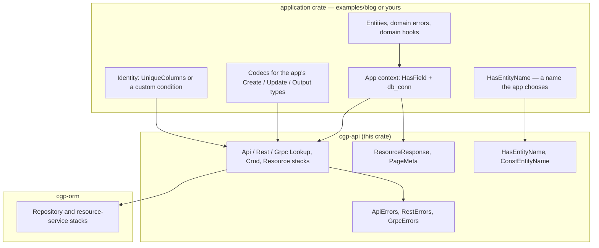

# cgp-api architecture

`cgp-api` is a **generic** application / service layer on
[`cgp-orm`](../cgp-orm). It owns error-mapping policies, stacked
presets, a routing-name accessor, and transport-independent response
helpers. It does **not** own a domain model: no entities, no fixed
DTO shape, and no transport-specific payload types.

The design principle, shared with `cgp-orm`: **presets compose
behavior, contexts choose policies, and macros do not own
architecture.**

# Layers

# Stacked presets

Each transport has three presets, all forwarding `ErrorType`,
`ErrorRaiser`, and `ErrorWrapper` to the corresponding error table:

| Preset | `cgp-orm` parents | Error map |
| --- | --- | --- |
| `ApiLookupStack` | `RepositoryLookupStack` | `ApiErrors` (`ApiError`) |
| `ApiCrudStack` | `RepositoryCrudStack` | `ApiErrors` (`ApiError`) |
| `ApiResourceStack` | `RepositoryCrudStack + ResourceServiceStack` | `ApiErrors` (`ApiError`) |
| `RestLookupStack` / `RestCrudStack` / `RestResourceStack` | same | `RestErrors` (`rest`) |
| `GrpcLookupStack` / `GrpcCrudStack` / `GrpcResourceStack` | same | `GrpcErrors` (`grpc`) |

A consumer writes a child preset that fills in:

- `EntityTypeProviderComponent`
- For a resource stack: `CreateInput` / `UpdateInput` / `Output` and
  the three codecs
- `UniqueColumnsGetterComponent` (or a custom identity)
- optionally `EntityNameGetterComponent`, write hooks, a tighter
  `UniqueConflictDetectorComponent`

Component keys use `cgp_orm::…` and `cgp_api::…` paths (`extern crate
self as cgp_api`) so they resolve when a consumer crate replays a
preset.

# Error maps

The generic tables map `cgp-orm` source errors and `sea_orm::DbErr`
(and `String` / `&str`). `ApiError` is a `thiserror` enum.
Applications with extra sources define their own enum, embed
`ApiError` with `#[from]`, and raise library sources with
`RaiseViaApiError`. Raiser keys are `open`.
Error maps are `delegate_components!` tables, not `cgp_preset!`s:
preset expansion drops lifetime and type parameters on `@` keys.

# Service types and codecs

`cgp-orm` exposes associated types `CreateInput`, `UpdateInput`, and
`Output`. This crate re-exports the codec traits and does not dictate
the types. `examples/blog` uses three distinct structs per resource;
an application may equally map all three to one shared type.

# Transport helpers

`ResourceResponse<T, M = ()>` and `ResourceResponseList<T, M>` are
generic wrappers with optional metadata. `response_from_page` copies
a `cgp-orm::Page` into `PageMeta`. Transports own HTTP / RPC mapping;
these helpers do not depend on Axum, tonic, or protobuf.

# Examples as proof

- `examples/blog` — UUID users, distinct post DTOs, composite-key
  favorites, composed from `ApiResourceStack` / `ApiCrudStack`.

# Tests

- `tests/helpers.rs` — response wrappers and REST error conversion.
- `examples/blog/tests/sqlite.rs` — in-memory SQLite, run with
  `cargo test --workspace`.
