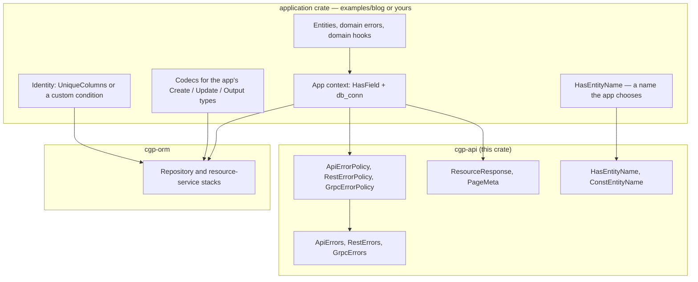

# cgp-api architecture

`cgp-api` is a **generic** application / service layer on
[`cgp-orm`](https://crates.io/crates/cgp-orm). It owns error-mapping policies, a
routing-name accessor, and transport-independent response helpers. It
does **not** own a domain model: no entities, no fixed DTO shape, and
no transport-specific payload types.

The design principle, shared with `cgp-orm`: **presets compose
behavior, contexts choose policies, and macros do not own
architecture.**

# Layers

# Error-policy presets

There is one policy preset per error table. Each forwards `ErrorType`,
`ErrorRaiser`, and `ErrorWrapper` to that table and does **not** wrap
a `cgp-orm` parent. The context adds the ORM stack:

| Policy | Error map | Typical composition |
| --- | --- | --- |
| `ApiErrorPolicy` | `ApiErrors` (`ApiError`, feature `thiserror`) | `RepositoryCrudStack + ResourceServiceStack + ApiErrorPolicy`, or `RepositoryLookupStack + ApiErrorPolicy` |
| `RestErrorPolicy` | `RestErrors` (feature `rest`) | same parents, with `RestErrorPolicy` |
| `GrpcErrorPolicy` | `GrpcErrors` (feature `grpc`) | same parents, with `GrpcErrorPolicy` |

A consumer writes a child preset that fills in:

- `EntityTypeProviderComponent`
- For a resource stack: `CreateInput` / `UpdateInput` / `Output` and
  the three codecs
- `UniqueColumnsGetterComponent` (or a custom identity)
- optionally `EntityNameGetterComponent`, write hooks, a tighter
  `UniqueConflictDetectorComponent`

Component keys use `cgp_orm::…` and `cgp_api::…` paths (`extern crate
self as cgp_api`) so they resolve when a consumer crate replays a
preset.

# Error maps

The generic tables map `cgp-orm` source errors and `sea_orm::DbErr`
(and `String` / `&str`). `ApiError` is a `thiserror` enum.
Applications with extra sources define their own enum, embed
`ApiError` with `#[from]`, and raise library sources with
`RaiseViaApiError`. Raiser keys are `open`. Extension is that
open raiser plus the embedded `ApiError`, not an `anyhow` table
and not a copy of the `ApiErrors` source list. A compiling
example is the `child_table_raises_an_app_error` test.

At the REST and gRPC boundary, `RaiseRestInternal` and
`RaiseGrpcInternal` send a fixed `"internal error"` string for
`DbErr` and for unexpected `String` / `&str`. The full error stays
on in-process `ApiError` (callers there need the SQL) and on the
transport error's `source()`. This crate does not add a logger or
a debug-errors feature: there is no `tracing` dependency, and an
off-by-default leak switch gets left on. An application that wants
the raw text on a private network overrides that one open raiser
key.

Error maps are `delegate_components!` tables, not `cgp_preset!`s:
preset expansion drops lifetime and type parameters on `@` keys.

# Service types and codecs

`cgp-orm` exposes associated types `CreateInput`, `UpdateInput`, and
`Output`. This crate re-exports the codec traits and does not dictate
the types. `examples/blog` uses three distinct structs per resource;
an application may equally map all three to one shared type.

# Transport helpers

`ResourceResponse<T, M = ()>` and `ResourceResponseList<T, M>` are
generic wrappers with optional metadata. `response_from_page` copies
a `cgp-orm::Page` into `PageMeta`. Transports own HTTP / RPC mapping;
these helpers do not depend on Axum, tonic, or protobuf.

# Examples as proof

- `examples/blog` — UUID users, distinct post DTOs, composite-key
  favorites, composed from `RepositoryCrudStack` (plus
  `ResourceServiceStack` for users and posts) and `ApiErrorPolicy`.

# `#[entity_api]` (feature `macros`)

The optional `#[cgp_api::entity_api]` attribute generates a context. It
does **not** generate error tables, stacks, codecs, or name providers.
Error policies and application stacks stay handwritten.

`policy = api | rest | grpc` plus `layer` (default `resource`) expands
to the `cgp-orm` parents and the matching error policy:

| layer | parents |
| --- | --- |
| `lookup` | `RepositoryLookupStack` + `{Api,Rest,Grpc}ErrorPolicy` |
| `crud` | `RepositoryCrudStack` + policy |
| `resource` | `RepositoryCrudStack` + `ResourceServiceStack` + policy |

The generated `{Name}Preset` is those parents plus `{Name}Base` (entity,
codecs, identity). `policy` may also be a custom error-preset path; then `error` is required.

`stack =` is a single path or a `+`-sum of paths (for example
`RepositoryCrudStack + ResourceServiceStack + RfErrorPolicy`). `error`
is required. The same grammar is accepted on `also` entries.

`cfg` is never implied. Set `cfg = "rest"` to gate one generated context
on a feature of the consumer crate. A keyword policy does not emit
`#[cfg(feature = "thiserror")]`, `rest`, or `grpc`. Those names are
features of *this* crate; an application usually enables them on the
`cgp-api` dependency and does not declare them itself. `policy = rest`
or `grpc` still needs that dependency feature, because the policy type
only exists then. The gRPC error type in the generated check is
`cgp_api::error::Status` (a re-export of `tonic::Status`).

`also(PostRestApi: rest)` keeps the parent layer and switches the
policy. `layer` on an `also` entry selects a different ORM parent
(`also(PostLookup: api, layer = lookup)`). Codecs live on the shared
base, so `layer = resource` there requires the primary context to set
`create`, `update`, `output`, and a codec. A lookup or crud `also` of
a resource context is valid.

`name = Tag` wires
`EntityNameGetterComponent: ::cgp_api::providers::ConstEntityName<Tag>`.

The generated struct must contain `db_conn`. `cgp-orm` derives
`HasDbConn` from that field name. The macro also derives `HasField`
and `Clone`. A `#[derive]` on the struct, below `#[entity_api]`, may
repeat those two; they are not derived twice.

`{Name}Preset::with_components!` checks every inherited key except the
three error components and any `extra` keys. Those are checked with
their real types on the context table. `extra` stays on
`delegate_components!`, so a key that already exists on a parent is
replaced there (paths must match the parent key tokens).

# Tests

- `tests/helpers.rs` — response wrappers and REST error conversion.
- `src/error/*.rs` — in-process, REST, and gRPC raisers, including the
  opaque-internal-error split and a child error-table extension.
- `cgp-api-macros/compile-tests` — `#[entity_api]` shorthand (`api` /
  `rest` / `grpc`, lookup / crud / resource), explicit stacks, `also`,
  and split codecs. `cgp-api-macros/tests/ui` — argument and struct errors.
- `examples/blog/tests/sqlite.rs` — in-memory SQLite, run with
  `cargo test --workspace`. Includes a `RestErrorPolicy` conflict
  check as `RestError`. `cargo test -p cgp-api` stays a helper test;
  `--workspace` is the real suite.

# Transactions

Multi-resource work that must share one SeaORM transaction should use
[`cgp_orm::transaction::run_in_transaction`](https://docs.rs/cgp-orm/latest/cgp_orm/transaction/fn.run_in_transaction.html)
(documented in cgp-orm's
[ARCHITECTURE.md](https://github.com/Just-Replicant/cgp-orm/blob/main/ARCHITECTURE.md)
and that function's rustdoc). This crate does not add a helper that
builds several application contexts around one `DatabaseTransaction`;
that would start owning application wiring.

# How to return 404

`CanGetResource::get` returns `Result<Option<Output>, _>`. A missing
row is success. `ErrEntityNotFound` is mapped to 404 by `RestErrors`
(and to `NOT_FOUND` by `GrpcErrors`) but is never raised by the
default provider, so a handler that only matches `RestError` answers
200 with an empty body. Leave `get` as `Option`. An opt-in helper
next to the trait in `cgp-orm` (`get_or_not_found`) raises
`ErrEntityNotFound`. The REST map already has the raiser.

# Semver

Adding a component key to a parent preset is a breaking change for
anyone who already assigned that key. A child preset that filled
`SomeComponent: TheirProvider` will fail to compile (a conflict, or
an explicit `override` becomes required) if a parent starts wiring
that same key. New keys on `ApiErrorPolicy`, `RestErrorPolicy`, and
`GrpcErrorPolicy` are breaking, including during 0.x. New keys on the
`cgp-orm` stacks are governed by that crate.

# Security and names

This crate does not authenticate, and a live `db_conn` behind a route
is full CRUD. There is no `CanAuthorize`. `HasEntityName` is a
compile-time `&'static str` literal. Examples are under the same
parent AGPL-3.0-or-later license as this crate.
